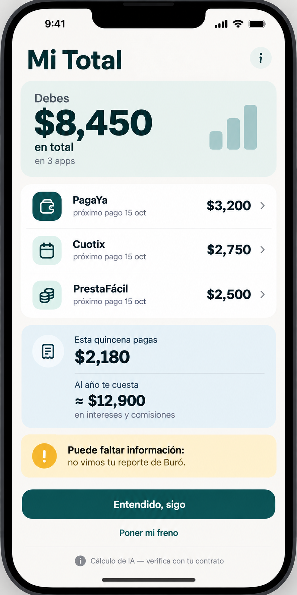
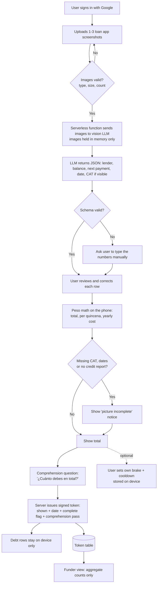
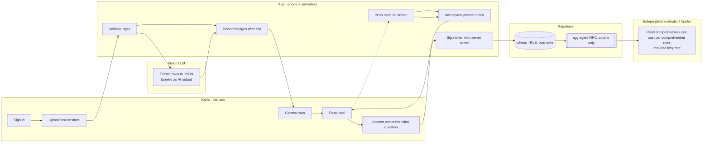

# PACKET — Week 10 · Business Bending
**Isle of Happiness: When someone optimizes your life for you**
Role: **MONEY** · Josep Ferré Gil · Team 7
Vacuum: **Debt guardrails** · Blueprint declaration: *"A financing model based on an industry contribution, with pay tied to comprehension. Honors #3."*
Working name: **Mi Total**

---

## 1. Problem (in my words)
In Mexico, the expensive regret is not the jacket you return. It is the jacket you financed alongside two other loans. Sellers and lenders have engineered every second of checkout. The buyer has nothing on their side at the moment the next loan lands. Most stackers can't say what they owe in total: 40% of BNPL users underestimate it (AMFD, indicative) and only 39.5% track their debts (ENIF 2024).

My Money question sits on top of that: **if an industry levy ever pays for a buyer-side agent, what exactly is it paying for, and how do we prove it works before anyone writes a law?** The Blueprint answers: pay on *comprehension*, never on loans prevented. Nobody has built the thing that measures comprehension. That is this slice.

## 2. Exact user
**Primary — the stacker.** Karla, 24, Iztapalapa, cashier, paid by quincena. No bank credit card. Two BNPL apps and one loan app active. Lives in WhatsApp. Afraid of montadeudas; distrusts any new app that asks for her data. She has never added up what she owes.

**Secondary — the independent evaluator / funder.** The person who would decide whether a levy (or a pilot SOFOM) keeps paying the operator. Sees only aggregate counts, never a person.

## 3. Success definition
> **Before the module closes:** at a live URL, a signed-in user uploads 1–3 screenshots of loan apps, sees their total debt and its cost in pesos per quincena and per year, is told honestly if the picture is incomplete, answers one question ("¿cuánto debes en total?"), and receives a signed "full debt picture shown" token. The server stores only that token. A funder view shows the comprehension rate and cost per comprehended user from aggregate data, and the levy rate needed to fund it.

## 4. Mockup (image-generated)
 — generated with my LLM's image tool using this prompt:

> Mobile app UI mockup, clean and calm, Spanish text, soft off-white background, one accent color (deep teal). Phone screen titled "Mi Total". Top: a large peso figure "Debes $8,450 en total" with small text "en 3 apps". Below: three rows — "PagaYa $3,200", "Cuotix $2,750", "PrestaFácil $2,500" — each with "próximo pago 15 oct". A card: "Esta quincena pagas $2,180 · Al año te cuesta ≈ $12,900 en intereses y comisiones". A yellow notice: "Puede faltar información: no vimos tu reporte de Buró". Bottom: a button "Entendido, sigo" and a smaller link "Poner mi freno". A small grey label at the very bottom: "Cálculo de IA — verifica con tu contrato". No logos of real companies, no people.

(App uses invented lender names in the demo — see Security Floor.)

## 5. Flow

### 5a. Flowchart — how the feature works


### 5b. Swimlane — who does what


## 6. Benchmark line
- **The best existing solution on Earth for this is** the UK Money and Pensions Service debt-advice levy (collected by the FCA, ~£102M in 2020-21): financial firms are required to fund free debt advice delivered by independent partners.
- **Mine differs/localizes by** paying for *prevention at the next loan* instead of repair after default, delivered by AI at ~MX$150–250 per gated user instead of human counselors Mexico doesn't have, and paying the operator on measured comprehension so the funder can see what each peso bought.

## 7. Long view (3 years)
If this slice works, Mi Total becomes the certified, lender-independent "full picture shown" step that a SOFOM pilot, then a group of licensed lenders, attach to every loan after the second active one — with the token as the only thing that ever leaves the phone. The comprehension dashboard becomes the contract instrument: the evidence an evaluator uses to decide whether the operator keeps getting paid, and the evidence Money takes to Congress to justify a levy on interest and late fees. If the pilot shows no measurable deflection in 12 months, the sunset clause kills it — and that, too, is a result worth having.

## 8. Scope cut — what I am NOT building
- No WhatsApp bot (template approval and Meta's 2026 policy are out of scope for one week).
- No connection to Buró, Círculo, Belvo or any bank. No bank passwords, ever.
- No real registry and no real lender integration — the token is signed but nobody consumes it yet.
- No blocking, no denial, no "you shouldn't" language. No credit scoring of any kind.
- No storage of screenshots, transcripts or debt rows on the server.
- No real levy calculation from real market data — the funder view uses editable assumptions, labeled.
- The self-set brake is a stretch goal (it's the USER teammate's declaration).
- Not a store and not a recommendation engine for sellers (Forbidden Zone).

## 9. Architecture + stack (free only)

| Layer | Choice | Why |
|---|---|---|
| Frontend | Next.js (App Router) + Tailwind | Fast, deploys to Vercel free |
| Hosting | Vercel (Hobby) | Free; secrets in environment variables |
| Auth | Supabase Auth — Sign in with Google | Security Floor: tokens are tied to a person |
| Database | Supabase Postgres, RLS on | One table: `tokens` |
| AI (LLM + vision) | Gemini Flash via free tier API *(verify current free-tier limits)* | Reads screenshots → JSON |
| Fallback | Labeled "SIMULATED AI OUTPUT" mock extractor | Demo still works if quota runs out |
| On-device storage | `localStorage` (try/catch) | Debt rows and brake never leave the phone |
| Token signing | HMAC-SHA256, secret in Vercel env | Registry-ready proof without content |
| Charts (funder view) | Recharts | Free, simple |

**Dragon Stack check:** LLM + user-constraint data (their debts, quincena, payment dates) + vision (screenshots).

**Data model — the whole server-side footprint:**
```
tokens
  id              uuid pk
  user_id         uuid  -> auth.users   (RLS: user reads only own rows)
  issued_at       timestamptz
  picture_complete boolean
  comprehension_pass boolean           (answer within ±10% of computed total)
  loans_count     smallint             (2, 3, 4+ — no amounts)
  signature       text                 (HMAC of the above)
```
No amounts, no lender names, no images. Funder view reads a `security definer` RPC that returns counts only (sessions, % complete, % comprehension pass), never rows.

**Peso math (shown on screen as an approximation):**
- Total = Σ balances
- Per quincena = Σ payments due within the next 15 days
- Yearly cost ≈ Σ (balance × CAT) when CAT is known; otherwise marked "desconocido" and the picture is flagged incomplete.

**Funder view math (editable assumptions, labeled as estimates):**
- Cost per gated user (default MX$150–250, my estimate)
- Cost per *comprehended* user = cost per gated user ÷ comprehension rate
- Users fundable = levy pool ÷ cost per comprehended user
- Required levy rate on lender revenue to fund N users

## 10. Blueprint conditions — how this slice honors them
1. **Shadow clause** — images live in memory for one API call, then are discarded; debt rows only on device; server stores only the token. No bank passwords.
2. **Never blocks or judges** — token issues whether or not the user passes the question; copy reviewed for moral language.
3. **Funding independent, paid on comprehension** — the funder view is exactly this metric, from aggregates an independent evaluator can read.
4. **Human escalation** — persistent footer: CONDUSEF and Consejo Ciudadano 55 5533 5533 for montadeuda threats.
5. **Evidence before scale** — funder view shows a "sunset at 12 months" banner and what it would take to pass.
6. **Honesty about blindness** — explicit "puede faltar información" notice when data is missing.

## 11. Security Floor plan
- 🔑 Gemini key and HMAC secret only in Vercel env vars; `.env*` in `.gitignore`.
- 🔐 Google sign-in required before any upload.
- 🚪 RLS on `tokens`: `user_id = auth.uid()` for select/insert; no update/delete.
- 🧹 Validation: max 3 images, PNG/JPEG only, ≤4 MB each; LLM output parsed against a Zod schema; amounts 0–1,000,000; comprehension answer numeric only.
- 🎭 Demo screenshots are invented (fictional apps "PagaYa", "Cuotix", "PrestaFácil"); labeled as fake.

## 12. Test plan

**Mechanical pass**
| # | Test | Expected |
|---|---|---|
| 1 | Upload while signed out | Redirect to sign-in |
| 2 | Upload a PDF / a 10 MB image / 4 images | Rejected with clear message |
| 3 | Upload 3 fictional screenshots | Rows extracted, labeled "AI" |
| 4 | LLM returns malformed JSON | Manual entry form appears |
| 5 | Screenshot with no CAT | Yearly cost "desconocido" + incomplete notice |
| 6 | Answer within ±10% / outside | Token issued both times; pass flag differs |
| 7 | Check Supabase after a session | Only token row; no amounts, no images |
| 8 | Query another user's token via API | RLS denies |
| 9 | Funder view | Counts only; changing assumptions updates levy math |
| 10 | Grep repo for keys | None |

**Persona pass** — fresh chat, persona: *"You are Karla, 24, cashier, paid by quincena, three loan apps, reads quickly but distrusts any app asking for her data because a friend was threatened by a montadeuda; you quit the moment something looks like a scam."* Walk her through each screen by screenshot; log hesitation points; fix the worst one; redeploy.

## 13. Commit + deploy plan (min. 5 commits, 2 deploys)
1. Scaffold Next.js + Supabase Google auth → **deploy 1**
2. Upload form + validation
3. Vision extraction + schema + simulated fallback label
4. On-device peso math + incomplete notice
5. Comprehension question + signed token + RLS table
6. Funder view (aggregate RPC + levy math) → **deploy 2**
7. Persona-test fix → **deploy 3**

Every session ends: `DECISIONS.md` updated, tomorrow's first move noted, commit, push.

## Sources (from team research — verify before building on them)
Kueski CAT 153.31% (bancario.com.mx, Mar 2026) · ENIF 2024 via Veritas · AMFD study via El Imparcial (Mar 2025) · MaPS levy (GOV.UK/FCA 2020) · Bertrand & Morse, J. Finance 66 (2011) via J-PAL · Meta WhatsApp Business policy (respond.io, 2026) · Fintech Law Art. 76 status (Fiskil 2026). Cost figures are my estimates.
